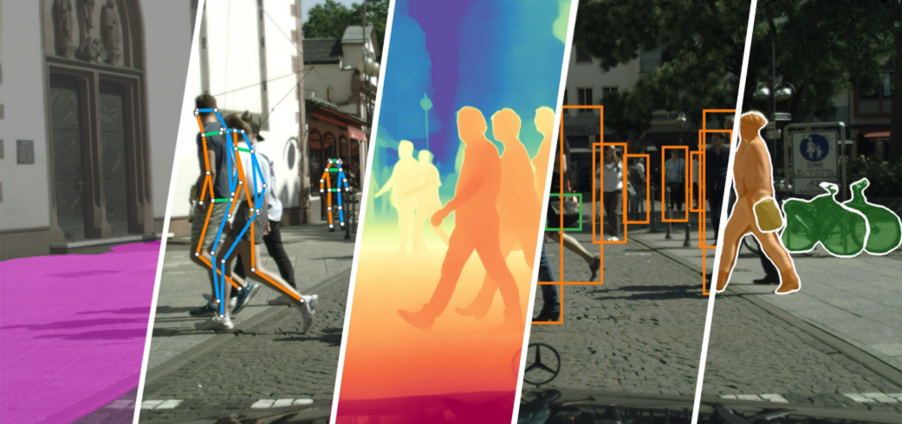

[简体中文](README.md) | **English**

# AutoVision

An enterprise-grade visual model training framework: train → evaluate →
export → deploy. Its flagship model family is
**[GTR](https://github.com/Intellindust-AI-Lab/GTR)** (MIT): one shared
backbone covering six tasks, with all 26 official weights registered and
ready to download. The Python API and `autovision-cli` (30 commands) share
one strict Pydantic validation surface.

Current version: **0.6.2**. It targets teams that need self-hosted training,
evaluation, export and private deployment; it is not a hosted API and does
not replace a production gateway. Core code is Apache-2.0; weight licenses
are registered per asset in the [model zoo](docs/model_zoo.md), and
restricted-license weights are not downloaded by default.

> This is the English entry point. The Chinese [README](README.md) is the
> canonical long-form document. Some deep documentation pages currently fall
> back to the Chinese original until translated.

## GTR: one backbone, six tasks

GTR (MIT) covers detection, instance segmentation, semantic segmentation,
depth estimation, oriented detection and pose estimation with one shared GLA
backbone + ViT adapter; each task only swaps the head / decoder. AutoVision
registers **all 26 official weights** (sha256-pinned) and verifies
weight loading and forward numerics bit-for-bit.



| Task (benchmark) | Model keys | Official metric | Weight assets |
|---|---|---|---|
| Detection (COCO) | `detr/gtrvit-<s\|m\|l\|x>` | AP 53.6 / 57.3 / 58.9 / 59.4 | `gtr_{s,m,l,x}_coco` |
| Instance seg (COCO) | `gtr/<s\|m\|l\|x>` | mask AP 45.0 / 47.7 / 49.5 / 49.8 | `gtrseg_{s,m,l,x}_coco` |
| Semantic seg (Cityscapes) | `gtr/<s\|m\|l\|x>` | mIoU 81.5 / 83.0 / 83.2 / 83.3 | `gtrsemseg_{s,m,l,x}_cityscapes` |
| Depth (NYU) | `gtr/<s\|m\|l\|x>` | absRel 0.074 / 0.069 / 0.069 / 0.067 | `gtrdepth_{s,m,l,x}` |
| Oriented det (DOTA) | `gtr/<s\|x>` | AP50 80.0 / 81.3 | `gtrobb_{s,x}_dota` |
| Pose (COCO) | `gtr/<s\|m\|l\|x>` | kp AP 70.1 / 74.1 / 74.7 / 75.5 | `gtrpose_{s,m,l,x}_coco` |
| Det pretrain (Objects365, as init) | — | — | `gtr_{s,m,l,x}_obj365` |

For installation, hands-on usage and finetuning see
[Quick start](#quick-start).

**Boundary**: the GTR eager forward needs Triton (CUDA-only, `gtr` extra);
CPU deployment goes through the ONNX backend. Export uses the pure-ONNX GLA
lowering (fixed-size graphs, fp16 available) and supports ONNX / TensorRT /
OpenVINO. Mirrors, caching and upstream gated repos are covered in
[weight downloads](docs/download_weights.md); per-asset licenses and official
metrics in the [model zoo](docs/model_zoo.md).

## Installation

Python ≥ 3.10. Install from PyPI (distribution name `autovision-framework`,
import name remains `autovision`; an unrelated `autovision` 0.0.1 package
exists on PyPI):

```bash
pip install "autovision-framework[gtr,download,export]"
```

From the repository root (source installation):

```bash
pip install -e ".[gtr,download,export]"   # GTR backbone + weight downloads + ONNX export
```

Other extras (`transformers` / `timm` / `rfdetr` / `super-gradients` /
`video` / `serving` / `dev` and more training, inference and development
components) are listed in `pyproject.toml`; weight downloads, mirrors and
restricted-license gates are covered in
[docs/download_weights.md](docs/download_weights.md).

## Quick start

The GTR end-to-end flow (eager inference needs CUDA; CPU deployment goes
through the ONNX backend).

**1. Install + download official weights**

```bash
pip install -e ".[gtr,download,export]"
python scripts/download_gtr_assets.py --task det   # detection weights; --all for all 26
```

**2. No training: load official weights, predict, export**

```python
import autovision

model = autovision.detection("detr/gtrvit-s", pretrained=True)  # official MIT weights
result = model.predict("image.jpg")   # {'bboxes': ..., 'scores': ..., 'labels': ...}
model.export("model.onnx")            # ONNX export, parity gate on by default
```

**3. Finetune from official weights** (pose shown; other tasks are shaped
the same — swap the task entry and asset name, see
[task entry points](#task-entry-points))

```python
result = autovision.train_pose_estimation(
    out="runs/pose", data=data,       # COCO person_keypoints JSON + images
    model="gtr/s",
    model_args={"checkpoint": "gtrpose_s_coco"},   # omit for random init
)
print(result.best_exported_model_path, result.metrics)
```

Equivalent CLI (same Pydantic validation):

```bash
autovision-cli list-models --task detection --pretrained   # GTR / RF-DETR keys
autovision-cli train-pose-estimation out=runs/pose data=pose.yaml model=gtr/s \
    model_args='{"checkpoint": "gtrpose_s_coco"}'
autovision-cli predict model=runs/pose/exported_models/exported_best.pt images=dir/ out=preds/
```

Each task ships an inference and a training example under `examples/tasks/`,
all defaulting to GTR (inference loads the official MIT weights; training
runs a tiny random-init configuration on CUDA with the `gtr` extra);
`--dry-run` prints the data contract. See
[docs/task_examples.md](docs/task_examples.md).

## Task entry points

All tasks share one API / CLI shape: the Python API is `train_<task>` (e.g.
`train_pose_estimation`) and the CLI is the kebab-case twin. The model column
prefers the GTR route: it uniformly needs the `gtr` extra, and loading
official weights additionally needs `download`
(`scripts/download_gtr_assets.py`;
`model_args={"checkpoint": "<asset>"}` with asset names in the
[GTR table](#gtr-one-backbone-six-tasks)). Panoptic segmentation and
classification have no GTR route yet.

| Task | Model | Data form | Notes |
|---|---|---|---|
| Detection | `detr/gtrvit-<s\|m\|l\|x>` | COCO / YOLO | — |
| Pose estimation | `gtr/s` | COCO keypoints | — |
| Depth estimation | `gtr/s` | images + depth (`.npy` meters or 16-bit PNG) | — |
| Instance segmentation | `gtr/<s\|m\|l\|x>` | COCO | `num_classes` required |
| Semantic segmentation | `gtr/<s\|m\|l\|x>` | images + masks PNG | `num_classes` required |
| Oriented detection | `gtr/<s\|x>` | DOTA / YOLO-OBB | — |
| Panoptic segmentation | `dinov2/eomt` (no GTR yet) | COCO panoptic | `transformers` extra |
| Classification | `torchvision/resnet18` (no GTR yet) | ImageFolder `train/`, `val/` | — |

`dinov2/eomt` and GTR models depend on DINOv2 and GTR official weights
respectively; use `-notpretrained` variants or local checkpoints in offline
or restricted-network environments.

## More capabilities (collapsed)

<details>
<summary>GTR training and deployment notes</summary>

- **Eager forward**: relies on fla Triton kernels (CUDA-only). Building a
  `backend='torch'` engine on CPU fails with a readable error — use
  `backend='onnx'` or CUDA; CPU deployment goes through the ONNX backend.
- **Export**: tracing swaps in the pure-ONNX GLA lowering automatically
  (eager path unchanged), producing fixed-size graphs
  (`dynamic_spatial=True` is rejected fast). fp16 works (the GLA fp32 state
  segment is pinned via `onnx_fp32_op_types`), but GTR is GEMM-heavy —
  prefer fp32 graphs on ORT CPU; let TensorRT manage precision from an fp32
  graph. End-to-end gates live in `tests/test_gtr_export_gates.py`.
- **Training recipe**: the official pose recipe is `precision="32-true"`
  (AMP off); official augmentations (mosaic / mixup / zoom-out) are not
  ported.
- **Objects365 weights** (`gtr_{s,m,l,x}_obj365`) can initialize detection
  finetuning.

</details>

<details>
<summary>Model registry and metrics</summary>

The [model zoo](docs/model_zoo.md) is generated from the registries and lists
every asset with license, sha256, official metric and a loading snippet: the
41 registered detection keys (DINOv2 / DINOv3 ViT, DINOv3 ConvNeXt, GTR GLA,
timm HGNetV2 backbones plus `detr/n` / `detr/s` tier aliases), the GTR
26-weight family above, in-tree RT-DETR / D-FINE / PicoDet, and the
user-held DINOv3 detectors (out-of-tree, non-redistributable, 3 STA-era
checkpoints rejected by the loader). DINOv2/v3 ViT models use the no-STA
adapter; legacy checkpoints containing `backbone.sta.*` are refused.

</details>

<details>
<summary>Export and deployment</summary>

`model.export(...)` dispatches by suffix (`.onnx` / `.engine` / `.xml` /
`.pt`) and runs numerical parity gates by default:

```python
result = autovision.train_object_detection(out="runs/det1", data="coco8", steps=2000)
model = autovision.load_task_model(result.best_exported_model_path)
model.export_onnx("model.onnx", precision="fp16")
```

Detection exports write a `<artifact>.postprocess.json` sidecar (top-k,
threshold, preprocessing) so device-side consumers can reproduce final boxes
via `autovision.export.decode_detections_numpy`; `verify_end_to_end_parity`
compares final boxes / scores / labels across backends as a release gate.
A minimal C++ ONNX Runtime + OpenCV runtime lives under `examples/cpp/`.
See [docs/export.md](docs/export.md) for int8, dynamic shapes and TensorRT 11.

</details>

<details>
<summary>Video / RTSP inference and tracking</summary>

```bash
pip install -e ".[video]"
autovision-cli predict model=exported_best.pt source=clip.mp4 out=preds/ batch_size=4
autovision-cli predict model=exported_best.pt sources=rtsp://cam1/live,rtsp://cam2/live out=preds/
autovision-cli predict model=exported_best.pt source=clip.mp4 out=preds/ track=true   # ByteTrack
```

Single-stream runs write `predictions.jsonl` + `annotated.mp4`; multi-stream
runs share batching with per-source artifacts, reconnect and backpressure.
Tracking adds per-frame `tracks` records; `LineZone` / `PolygonZone`
analytics are available via `run_stream(..., track=True)`.

</details>

<details>
<summary>Reference serving (FastAPI)</summary>

```bash
pip install -e ".[serving]"
autovision-cli serve model=exported_best.pt port=8000
```

`POST /predict` (base64 batches, same pre/postprocessing as evaluation),
`/healthz`, `/readyz`, `/drift` (PSI), `/metrics` (Prometheus); optional API
key, request limits, concurrency gate, TLS, workers, in-process rate
limiting and A/B / canary routing (`create_app(variants=...)`). It is a
reference implementation, not a complete production gateway.

</details>

<details>
<summary>Advanced features</summary>

- **Self-supervised pretraining / distillation**: `autovision.pretrain(...)`
  — DINO / DINOv2 / DINOv3, SimCLR, DenseCL, DetCon, DistillationV3,
  in-training kNN probes.
- **Large-image tiled inference (SAHI)**: `predict_sahi(...)`, batched
  tiling, NMM merge, per-label cross-tile filtering.
- **Data versioning**: `autovision-cli data-snapshot` content-addressed
  snapshots with drift verification.
- **Early stopping and callbacks**: `trainer_args` (patience / min-delta) and
  Python training callbacks.
- **HPO**: random / grid / ASHA via `autovision-cli hpo`, resumable, with
  `report.md` + `trials.jsonl` + `best.json`.
- **Data loops**: VOC / CVAT / Label Studio conversion (`convert-data`),
  dataset QA (`data-check`), error analysis with FP attribution
  (`analyze-errors`), hard-example resampling, pseudo-label self-training,
  long-tail samplers.

</details>

## Industry solutions

Vertical scenario solutions built on AutoVision (solution engines consume the
framework's stable seams via `pip install autovision-framework`; see the
[industry solutions page](https://hi-ai-lab.github.io/AutoVision/en/ecosystem/)):

| Repository | Scenario |
| --- | --- |
| [ai-traffic](https://github.com/hi-agi-lab/ai-traffic) | Road incidents: FOD + composite accident scoring + congestion |
| [ai-wildfire](https://github.com/hi-agi-lab/ai-wildfire) | Wildfire + flood/typhoon video analytics |
| [ai-illop](https://github.com/hi-agi-lab/ai-illop) | SOP violation monitoring (checklist-driven acceptance) |
| [ai-conflict](https://github.com/hi-agi-lab/ai-conflict) | Public-order conflict analytics (long-tail T3) |
| [ai-perimeter](https://github.com/hi-agi-lab/ai-perimeter) | Perimeter intrusion video analytics |
| [ai-security](https://github.com/hi-agi-lab/ai-security) | General security video analytics |
| [ai-life-line](https://github.com/hi-agi-lab/ai-life-line) | Lifeline infrastructure video analytics |
| [ai-urban](https://github.com/hi-agi-lab/ai-urban) | Urban governance video analytics |

## Known limits

- Positioning: training + reference inference framework; serving is a
  reference implementation, not a production gateway.
- DINOv2 / DINOv3 weights are not downloaded by default (restricted
  licenses, explicit opt-in gates); `detr/n` / `detr/s` tiers are
  spec-frozen (weights pending).
- Dynamic H/W is not supported for HF backbones (`detr/dinov2-*`,
  `detr/dinov3-*`); ONNX FP16 parity needs a CUDA execution provider and
  degrades to an execute + finiteness smoke gate without one.
- GTR eager forward is CUDA-only (Triton); exports are fixed-size graphs;
  CPU deployment uses the ONNX backend.

See [docs/known_limits.md](docs/known_limits.md) for the full list.

## License and provenance

Core code is Apache-2.0; the full text is in repository `LICENSE` and at
<https://www.apache.org/licenses/LICENSE-2.0>. Third-party components and
weight provenance are listed in `NOTICE`,
[THIRD_PARTY_LICENSES.md](THIRD_PARTY_LICENSES.md) and
[docs/provenance/LEDGER.md](docs/provenance/LEDGER.md).

GTR weights are MIT (26 assets, sha256-pinned); `ultralytics` is AGPL-3.0
and isolated behind an extra; the user-held detector store (out-of-tree) is
non-redistributable. Boundaries in
[docs/user_held_weights.en.md](docs/user_held_weights.en.md).

Contributing and governance: [CONTRIBUTING.md](CONTRIBUTING.md) (environment
/ gates / provenance rules), release process
[docs/release_process.md](docs/release_process.md), changelog
[CHANGELOG.md](CHANGELOG.md); security disclosure in
[SECURITY.md](SECURITY.md) (no public issues, please).

## Acknowledgements

AutoVision benefits from PyTorch, torchvision, HuggingFace Transformers, ONNX
Runtime, NVIDIA TensorRT, OpenVINO, FastAPI, MLflow, Weights & Biases,
TensorBoard, [RT-DETR](https://github.com/lyuwenyu/RT-DETR),
[D-FINE](https://github.com/Peterande/D-FINE),
[DEIM](https://github.com/Intellindust-AI-Lab/DEIM),
[GTR](https://github.com/Intellindust-AI-Lab/GTR),
[ByteTrack](https://github.com/ifzhang/ByteTrack),
[SAHI](https://github.com/obss/sahi),
[Roboflow RF-DETR](https://github.com/roboflow/rf-detr), PicoDet and
supervision. The training / tracking / data / export engineering and the
self-supervised pretraining + model-registry design additionally draw on
[Ultralytics](https://github.com/ultralytics/ultralytics) and
[LightlyTrain](https://github.com/lightly-ai/lightly-train) (both AGPL-3.0).

> Translation status: this English README covers the main entry points. The
> Chinese README is the default/canonical long-form document; deep docs pages
> without an English translation fall back to Chinese until translated.
