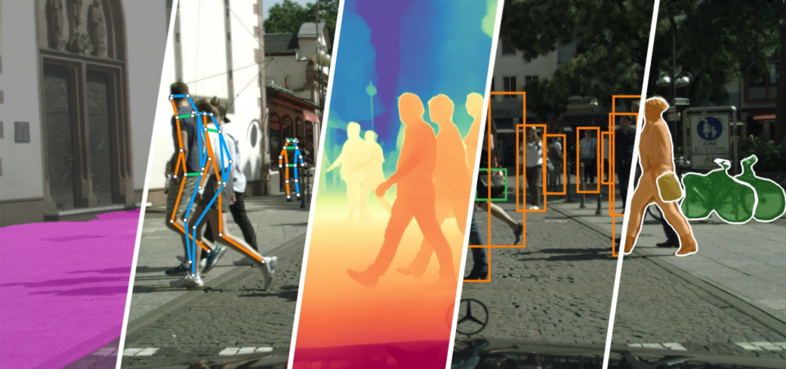

# AutoVision

**简体中文** | [English](README.en.md)

企业级视觉模型训练框架：训练 → 评测 → 导出 → 部署一条龙。旗舰模型家族
**[GTR](https://github.com/Intellindust-AI-Lab/GTR)**（MIT）一个共享骨干覆盖
六个任务，26 个官方权重全部注册、开箱即下。Python API 与 `autovision-cli`
（31 条命令）共享同一套 Pydantic 严格校验。

当前版本 **0.6.2**。适合需要自托管训练、评测、导出和私有部署的团队；不提供
托管 API，也不替代生产网关。核心代码 Apache-2.0，权重许可逐资产登记
（[模型库](docs/model_zoo.md)），受限许可权重默认不下载。


文档：[任务示例](docs/task_examples.md) · [模型库](docs/model_zoo.md) ·
[权重下载](docs/download_weights.md) · [导出与部署](docs/export.md) ·
[基准](docs/benchmarks.md) · [架构总览](docs/framework_design.md) ·
[已知限制](docs/known_limits.md) · [贡献](CONTRIBUTING.md)

**目录**：[GTR：一个骨干，六个任务](#gtr一个骨干六个任务) ·
[安装](#安装) · [快速开始](#快速开始) · [任务入口](#任务入口) ·
[更多能力](#更多能力折叠) · [行业方案](#行业方案) ·
[致谢](#致谢acknowledgements) · [已知限制](#已知限制) ·
[许可与溯源](#许可与溯源)

## GTR：一个骨干，六个任务

GTR（MIT 许可）用一套共享 GLA 骨干 + ViT adapter 覆盖检测、实例分割、
语义分割、深度、旋转框、姿态六条任务线，各任务只换头 / 解码器。
AutoVision 已将其 **26 个官方权重全部注册**（sha256 全钉住），官方权重的
加载与前向数值已做逐位对拍。



| 任务（基准集） | model 键 | 官方指标 | 权重资产 |
|---|---|---|---|
| 检测（COCO） | `detr/gtrvit-<s\|m\|l\|x>` | AP 53.6 / 57.3 / 58.9 / 59.4 | `gtr_{s,m,l,x}_coco` |
| 实例分割（COCO） | `gtr/<s\|m\|l\|x>` | mask AP 45.0 / 47.7 / 49.5 / 49.8 | `gtrseg_{s,m,l,x}_coco` |
| 语义分割（Cityscapes） | `gtr/<s\|m\|l\|x>` | mIoU 81.5 / 83.0 / 83.2 / 83.3 | `gtrsemseg_{s,m,l,x}_cityscapes` |
| 深度（NYU） | `gtr/<s\|m\|l\|x>` | absRel 0.074 / 0.069 / 0.069 / 0.067 | `gtrdepth_{s,m,l,x}` |
| 旋转框（DOTA） | `gtr/<s\|x>` | AP50 80.0 / 81.3 | `gtrobb_{s,x}_dota` |
| 姿态（COCO） | `gtr/<s\|m\|l\|x>` | kp AP 70.1 / 74.1 / 74.7 / 75.5 | `gtrpose_{s,m,l,x}_coco` |
| 检测预训练（Objects365，作初始化） | — | — | `gtr_{s,m,l,x}_obj365` |

安装、上手与微调见[快速开始](#快速开始)。

**边界**：GTR eager 前向依赖 Triton（CUDA-only，`gtr` extra），CPU 部署走
ONNX 后端；导出走 GLA 纯 ONNX 降级（固定尺寸图，fp16 可用），ONNX /
TensorRT / OpenVINO 全支持。镜像、缓存与上游 gated 仓库的处理见
[权重下载](docs/download_weights.md)；逐资产许可与官方指标见
[模型库](docs/model_zoo.md)。

## 安装

Python ≥ 3.10。直接从 PyPI 安装（发行名 `autovision-framework`，import 名
仍是 `autovision`；注意 PyPI 上另有一个无关的 `autovision` 0.0.1 包）：

```bash
pip install "autovision-framework[gtr,download,export]"
```

从源码安装（仓库根目录执行）：

```bash
pip install -e ".[gtr,download,export]"   # GTR 骨干 + 官方权重下载 + ONNX 导出
```

其余 extras（`transformers` / `timm` / `rfdetr` / `super-gradients` /
`video` / `serving` / `dev` 等训练、推理与开发组件）见 `pyproject.toml`；
权重下载、镜像与受限许可门控见
[权重下载](docs/download_weights.md)。

## 快速开始

GTR 全流程（eager 推理需 CUDA；CPU 部署走 ONNX 后端）。

**1. 安装 + 下载官方权重**

```bash
pip install -e ".[gtr,download,export]"
python scripts/download_gtr_assets.py --task det   # 检测权重；--all 下载全部 26 个
```

**2. 免训练：加载官方权重推理 / 导出**

```python
import autovision

model = autovision.detection("detr/gtrvit-s", pretrained=True)  # 官方 MIT 权重
result = model.predict("image.jpg")   # {'bboxes': ..., 'scores': ..., 'labels': ...}
model.export("model.onnx")            # ONNX 导出，默认数值对拍门禁
```

**3. 官方权重直载微调**（姿态为例；其余任务同形——换任务入口与资产名，
见[任务入口](#任务入口)）

```python
result = autovision.train_pose_estimation(
    out="runs/pose", data=data,       # COCO person_keypoints JSON + images
    model="gtr/s",
    model_args={"checkpoint": "gtrpose_s_coco"},   # 不传则随机初始化
)
print(result.best_exported_model_path, result.metrics)
```

等价命令行（同一套 Pydantic 校验）：

```bash
autovision-cli list-models --task detection --pretrained   # 可用 GTR / RF-DETR 键
autovision-cli train-pose-estimation out=runs/pose data=pose.yaml model=gtr/s \
    model_args='{"checkpoint": "gtrpose_s_coco"}'
autovision-cli predict model=runs/pose/exported_models/exported_best.pt images=dir/ out=preds/
```

每个任务都有"纯推理 + 训练"两个示例脚本，默认即 GTR（推理加载官方 MIT
权重；训练为 tiny 随机初始化配置，需 CUDA + `gtr` extra；`--dry-run` 只打印
数据契约）：

```bash
python examples/tasks/pose_estimation.py
python examples/tasks/instance_segmentation_train.py --dry-run
```

完整列表见 [任务示例](docs/task_examples.md) / `examples/tasks/README.md`。

## 任务入口

所有任务共用同一套 API / CLI 形式：Python API 名为 `train_<task>`
（如 `train_pose_estimation`），CLI 为同名 kebab-case（如
`train-pose-estimation`）；主要差异在 `data` 结构与必填参数。
模型列优先给出 GTR 路线：统一需 `gtr` extra，直载官方权重另需 `download`
（`scripts/download_gtr_assets.py`；`model_args={"checkpoint": "<资产名>"}`，
资产名见[GTR 表](#gtr一个骨干六个任务)）。全景分割与分类暂无 GTR 路线。

| 任务 | model | `data` 结构 | 额外要求 |
|---|---|---|---|
| 检测 | `detr/gtrvit-<s\|m\|l\|x>` | COCO / YOLO；VOC 先 `convert-data` | — |
| 姿态 | `gtr/s` | COCO `person_keypoints` JSON + images | — |
| 深度 | `gtr/s` | images + depths（`.npy` 米或 16-bit PNG） | — |
| 实例分割 | `gtr/<s\|m\|l\|x>` | COCO instances JSON + images | 必填 `num_classes` |
| 语义分割 | `gtr/<s\|m\|l\|x>` | images + masks PNG | 必填 `num_classes` |
| 旋转框 | `gtr/<s\|x>` | YOLO-OBB（8 点角点） | — |
| 全景分割 | `dinov2/eomt`（暂无 GTR） | images + masks PNG + segments JSON | `transformers` extra |
| 分类 | `torchvision/resnet18`（暂无 GTR） | ImageFolder `train/`、`val/` | — |

`dinov2/eomt` 与 GTR 模型分别依赖 DINOv2 权重与 GTR 官方权重；离线或受限
网络环境请使用 `-notpretrained` 变体或本地 checkpoint。

<details>
<summary>最小示例：旋转框 / 实例分割 / 姿态 / 语义分割（全部 GTR）</summary>

```python
import autovision

# 旋转框：data.yaml 使用 YOLO-OBB 布局
autovision.train_oriented_object_detection(
    out="runs/obb",
    data="obb.yaml",
    model="gtr/s",
)

# 实例分割：COCO instances JSON
autovision.train_instance_segmentation(
    out="runs/ins",
    data={
        "train": {"annotations": "instances_train.json", "images": "train2017"},
        "val": {"annotations": "instances_val.json", "images": "val2017"},
    },
    num_classes=80,
    model="gtr/s",
)

# 姿态：COCO person_keypoints；官方权重直载
autovision.train_pose_estimation(
    out="runs/pose",
    data={
        "train": {
            "annotations": "person_keypoints_train2017.json",
            "images": "train2017",
        },
        "val": {
            "annotations": "person_keypoints_val2017.json",
            "images": "val2017",
        },
    },
    model="gtr/s",
    model_args={"checkpoint": "gtrpose_s_coco"},
)

# 语义分割：成对 images / masks，255 为忽略标签
autovision.train_semantic_segmentation(
    out="runs/seg",
    data={"train": {"images": "images/", "masks": "masks/"}},
    num_classes=3,
    model="gtr/s",
)
```

</details>

## 更多能力（折叠）

<details>
<summary>GTR 训练与部署细节</summary>

- **eager 前向**：依赖 fla 的 Triton 核（CUDA-only）。CPU 上构造
  `backend='torch'` 的推理引擎会被可读报错拒绝——用 `backend='onnx'`
  或 CUDA；CPU 部署走 ONNX 后端。
- **导出**：trace 期自动换用 GLA 纯 ONNX 降级（eager 路径不变），生成
  固定尺寸图（`dynamic_spatial=True` 会被快速拒绝）；fp16 可用（GLA 的
  fp32 状态段经 `onnx_fp32_op_types` 钉住），但 GTR 以 GEMM 为主，
  ORT CPU 上 fp32 图更快——CPU 部署用 fp32，TensorRT 建议由 fp32 图
  自行管精度。五条路线端到端门禁见 `tests/test_gtr_export_gates.py`。
- **训练配方**：姿态官方配方为 `precision="32-true"`（关 AMP）；官方训练
  增广（mosaic / mixup / zoom-out）未移植。
- **Objects365 权重**（`gtr_{s,m,l,x}_obj365`）可作检测微调的初始化。

</details>

<details>
<summary>能力与子系统</summary>

- **一套校验、两个入口**：Python API 与 `autovision-cli`（31 条命令）共享
  Pydantic 严格校验；拼错或越界直接报错（did-you-mean）。
- **模型面**：7 个注册源（torchvision、timm、super-gradients、ultralytics
  （AGPL 隔离）、dinov2、dinov3、rfdetr）+ 树内 `rtdetr/*`、`detr/*`、
  `dfine/*`、`picodet/*`、`rfdetr/*`、`gtr/*` 装配，覆盖检测、分割、姿态、
  深度、分类。
- **训练与数据**：自监督预训练（DINO / DINOv2 / DINOv3、SimCLR、DetCon 等）、
  蒸馏、DDP / 混合精度 / 原子 checkpoint + resume；每次训练在输出目录写
  `run_manifest.json`（命令 / git commit / 环境白名单 / 依赖版本 / GPU）；
  mmap 文件清单与 VOC / YOLO 转换。
- **部署与闭环**：ONNX / TensorRT / OpenVINO + 数值对拍；伪标注、误差分析、
  HPO、内容寻址快照，均带 CLI。

子系统级细节见[架构总览](docs/framework_design.md)。

</details>

<details>
<summary>检测谱系 <code>detr/*</code> 与用户自持权重</summary>

41 个已注册检测键（39 个规格变体 + 2 个产品档位别名）；DINOv2 ViT（13）、
DINOv3 ViT（13）、DINOv3 ConvNeXt（7）、GTR GLA 骨干（4，见上）、timm
HGNetV2（2）+ `detr/n` / `detr/s` 档位别名（spec-frozen，权重待发布）。
DINOv2 与 DINOv3 ViT 均使用 no-STA adapter；含 `backbone.sta.*` 的旧检查点
会被加载器拒绝。完整谱系与逐变体配方见[模型库](docs/model_zoo.md)。

另有 7 个第三方训练的 COCO 检测器（DINOv3 骨干）经合规重打包后存于**仓库
之外**（`AUTOVISION_USER_HELD_ROOT`，默认 `~/Research/Model/AutoVision`）：
`DINOv3-License+NOASSERTION`，禁再分发 / 禁商用；其中 3 个 STA-era ViT
检查点已不被加载器支持，4 个 ConvNeXt 检查点仍可加载。使用即视为已自行
接受相应条款。见[用户自持权重指南](docs/user_held_weights.md)。

</details>

<details>
<summary>导出与部署</summary>

需要 `export` extra；OpenVINO `.xml` 另需 `openvino` extra，TensorRT 引擎需
自行安装 `tensorrt`。`model.export(...)` 按后缀分发（`.onnx` / `.engine` /
`.xml` / `.pt`），导出默认数值对拍门禁：

```python
result = autovision.train_object_detection(out="runs/det1", data="coco8", steps=2000)
model = autovision.load_task_model(result.best_exported_model_path)
model.export_onnx("model.onnx", precision="fp16")
autovision.benchmark("detr/gtrvit-s", out="bench/", num_classes=80,
                     backends={"torch": {}, "onnx": {"provider": "cpu"}},
                     verify_parity=True)
```

```bash
autovision-cli export model=runs/det1/exported_models/exported_best.pt out=model.onnx precision=fp16
autovision-cli export model=runs/det1/exported_models/exported_best.pt out=model.engine precision=int8 calibration_data=calib_images/
```

检测任务的导出件旁会写 `<artifact>.postprocess.json`（top-k / 阈值 / 预处理），
设备侧用 `autovision.export.decode_detections_numpy` 复现最终框；
`verify_end_to_end_parity` 比较最终框 / 分数 / 类别，适合作为跨后端发布
门禁。设备侧最小 C++ 参考实现见 `examples/cpp/`。动态 H/W 支持面、int8
配方与 TensorRT 11 适配见[导出与部署细节](docs/export.md)。

</details>

<details>
<summary>视频 / RTSP 推理与跟踪</summary>

```bash
autovision-cli predict model=exported_best.pt source=clip.mp4 out=preds/ batch_size=4
autovision-cli predict model=exported_best.pt source=rtsp://camera/live out=preds/ backend=onnx artifact=model.onnx
autovision-cli predict model=exported_best.pt sources=rtsp://cam1/live,rtsp://cam2/live out=preds/ batch_size=4
autovision-cli predict model=exported_best.pt source=clip.mp4 out=preds/ track=true   # ByteTrack
```

单路输出 `predictions.jsonl`（逐帧框，原始像素）+ `annotated.mp4`；多路
共享批处理、断流重连，汇总 `summary.json`。跟踪输出 JSONL 增加 `tracks`
（`track_id` / `bbox` / `score` / `class_id` / `age`）；`LineZone` /
`PolygonZone` 区域统计与滑动平均见 API `run_stream(..., track=True)`。
需 `.[video]`。细节见文档站「推理运行时」。

</details>

<details>
<summary>参考 serving（FastAPI）</summary>

```bash
pip install -e ".[serving]"
autovision-cli serve model=exported_best.pt port=8000
```

提供 `POST /predict`（base64 批处理，前后处理与评测同源）、`/healthz`、
`/readyz`、`/drift`（预测分布 PSI）、`/metrics`（Prometheus 文本）；可选
API key、请求体 / 像素上限、并发闸门、TLS、多 worker、进程内限流、
A/B / canary 分流（Python API `create_app(variants=...)`）。属参考实现而
非完整生产网关：跨 worker 聚合、全局配额、告警与金丝雀自动回滚仍属生产
网关 / 平台职责。

</details>

<details>
<summary>进阶功能</summary>

- **自监督预训练与蒸馏**：`autovision.pretrain(...)`，DINO / DINOv2 /
  DINOv3、SimCLR、DenseCL、DetCon、DistillationV3，训练中 kNN 探针。
- **大图切片推理（SAHI）**：`predict_sahi(image, tile_size, overlap, ...)`，
  `batch_size` 限制显存峰值，`merge="nmm"` 合并切断目标，tile 间统一
  per-label 过滤。
- **数据版本化**：`autovision-cli data-snapshot data=... out=... deep=true`
  写内容寻址快照，`snapshot=...` 校验漂移（非零退出）。
- **早停与回调**：`trainer_args='{"val_every_num_steps": 500,
  "early_stopping_patience": 5}'`；Python API 支持训练回调（rank 0 执行）。
- **超参搜索**：`autovision-cli hpo space=search.yaml ...`，随机 / 网格 /
  ASHA，产出 `report.md` + `trials.jsonl` + `best.json`，中断可续跑。
- **数据闭环**：VOC / CVAT / Label Studio 转 COCO（`convert-data`）、
  数据体检（`data-check`：坏图 / 重复 / split 泄漏）、误差分析
  （`analyze-errors`：FP 归因 + top-FP/FN 画廊）、难例回灌
  （`hard_examples=`）、伪标注自训练（`pseudo-label` +
  `scripts/self_train_detect.py`）、长尾采样（`long_tail_sampler=`）。

命令全表（31 条）：训练 9 条 `pretrain` / `train-*`；评测推理 `val` /
`predict` / `benchmark` / `embed` / `pseudo-label` / `analyze-errors`；
导出服务 `export` / `serve`；数据 `download` / `convert-data` /
`data-check` / `data-snapshot` / `tile-dataset`；治理 `list-models` / `model-info` /
`list-methods` / `plugins` / `compliance-report` / `registry`；工具 `hpo` /
`extract-video-frames` / `plot-curves`。

</details>

## 行业方案

基于 AutoVision 的行业场景方案（方案引擎经 `pip install autovision-framework`
消费本框架稳定接缝；介绍与接入见
[行业方案](https://hi-ai-lab.github.io/AutoVision/ecosystem/)）：

| 仓库 | 场景 |
| --- | --- |
| [ai-traffic](https://github.com/hi-agi-lab/ai-traffic) | 交通事件三域：遗撒散落物 + 事故复合评分分级 + 拥堵监测 |
| [ai-wildfire](https://github.com/hi-agi-lab/ai-wildfire) | 林草火险 + 防汛防台视频分析 |
| [ai-illop](https://github.com/hi-agi-lab/ai-illop) | 违规操作视频监管（SOP 分解、注册表驱动逐项验收） |
| [ai-conflict](https://github.com/hi-agi-lab/ai-conflict) | 治安冲突视频分析（T3 长尾专项） |
| [ai-perimeter](https://github.com/hi-agi-lab/ai-perimeter) | 周界防护视频分析 |
| [ai-security](https://github.com/hi-agi-lab/ai-security) | 安防通用视频分析 |
| [ai-life-line](https://github.com/hi-agi-lab/ai-life-line) | 生命线工程视频分析 |
| [ai-urban](https://github.com/hi-agi-lab/ai-urban) | 城市治理视频分析 |

## 致谢（Acknowledgements）

AutoVision 的架构与实现受益于以下开源工作。代码 lineage 与修改说明见
[溯源台账](docs/provenance/LEDGER.md)，第三方许可文本见
[THIRD_PARTY_LICENSES.md](THIRD_PARTY_LICENSES.md)，权重许可见
[模型库](docs/model_zoo.md)。

- **代码 / 算法 lineage**：[DEIM](https://github.com/Intellindust-AI-Lab/DEIM)
  （Apache-2.0）、[D-FINE](https://github.com/Peterande/D-FINE)（Apache-2.0）、
  [RT-DETR](https://github.com/lyuwenyu/RT-DETR)（Apache-2.0）、
  [Detectron2](https://github.com/facebookresearch/detectron2)（Apache-2.0）、
  [GTR](https://github.com/Intellindust-AI-Lab/GTR)（MIT）、
  [torch-linear-assignment](https://github.com/ivan-chai/torch-linear-assignment)
  （Apache-2.0）。
- **模型与权重**：[Roboflow RF-DETR](https://github.com/roboflow/rf-detr)
  （Apache-2.0）、[Intellindust GTR](https://github.com/Intellindust-AI-Lab/GTR)
  （MIT）、[Meta DINOv2](https://github.com/facebookresearch/dinov2)（代码
  Apache-2.0；权重 CC-BY-NC 4.0）、
  [Meta DINOv3](https://github.com/facebookresearch/dinov3)（权重 DINOv3
  License）、[PaddleDetection PP-PicoDet](https://github.com/PaddlePaddle/PaddleDetection)
  （Apache-2.0）。
- **跟踪 / 切片 / 可视化**：[ByteTrack](https://github.com/ifzhang/ByteTrack)
  （MIT）、[SAHI](https://github.com/obss/sahi)（MIT）、
  [Roboflow supervision](https://github.com/roboflow/supervision)（MIT）
  提供了算法参考；本仓库为 AutoVision 实现，不引入 supervision 运行时依赖。
- **训练工程参考**：[Ultralytics](https://github.com/ultralytics/ultralytics)
  （AGPL-3.0）提供了训练 / 追踪 / 数据 / 导出的工程化架构参考，
  [LightlyTrain](https://github.com/lightly-ai/lightly-train)（AGPL-3.0）
  提供了自监督预训练与模型注册表的设计参考；两者均为净室实现，
  `ultralytics` 仅以 AGPL extra 隔离惰性加载，LightlyTrain 零运行时依赖。
- **推理 / 训练工具**：PyTorch、torchvision、HuggingFace Transformers、
  ONNX Runtime、NVIDIA TensorRT、OpenVINO、FastAPI、MLflow、
  Weights & Biases、TensorBoard。
- **数据集**：COCO、PASCAL VOC、Cityscapes、DOTA、NYU Depth V2、Objects365、
  ImageNet；各自条款适用，不随本仓库分发。

## 已知限制

- 定位：训练 + 参考推理框架；serving 属参考实现，不替代生产网关。
- DINOv2 / DINOv3 权重默认不下载（受限许可，需显式门控开关）；
  `detr/n` / `detr/s` 档位为 spec-frozen（权重待发布）。
- 动态 H/W 不支持 HF 骨干（`detr/dinov2-*`、`detr/dinov3-*`）；ONNX FP16
  parity 需 CUDA execution provider，无 CUDA EP 时退化为「执行 + 有限性」
  smoke 门禁。
- GTR eager 前向 CUDA-only（Triton）；导出为固定尺寸图；CPU 部署走 ONNX
  后端。
- albumentations 适配层与 super-gradients 分割 wrapper 未接入。

完整边界与部署工程注记见[已知限制](docs/known_limits.md)。

## 许可与溯源

核心代码 Apache-2.0；许可证全文见仓库根目录 `LICENSE`
（也可查阅 <https://www.apache.org/licenses/LICENSE-2.0>）。第三方组件与
权重溯源见仓库根 `NOTICE`、[THIRD_PARTY_LICENSES.md](THIRD_PARTY_LICENSES.md)
与[溯源台账](docs/provenance/LEDGER.md)。

GTR 权重为 MIT（整族 26 个，sha256 钉住）；`ultralytics` 为 AGPL-3.0，仅作
extras 隔离加载；用户自持权重库（仓库外）禁再分发 / 禁商用。边界见
[用户自持权重指南](docs/user_held_weights.md)。

贡献与治理：[CONTRIBUTING.md](CONTRIBUTING.md)（环境 / 门禁 / 溯源红线）、
发布与版本政策 [docs/release_process.md](docs/release_process.md)、变更记录
[CHANGELOG.md](CHANGELOG.md)；安全漏洞披露见 [SECURITY.md](SECURITY.md)
（请勿公开 issue）。
